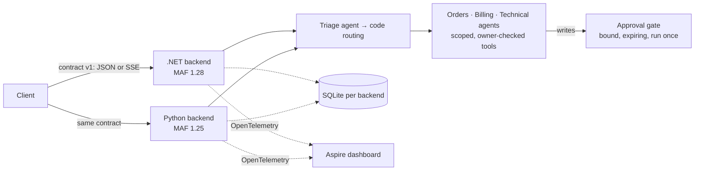

# MAF Support Lab

One customer-support agent system, built twice with **Microsoft Agent Framework**: in **C#** (ASP.NET Core, .NET 11) and in **Python** (FastAPI). Both implement one versioned API contract, run side by side under **Aspire**, and are checked against each other on every push.



## What it demonstrates

- **The model proposes; code decides.** Identity comes from the host, never the request. Ownership is checked in application services. Writes (cancel, refund, ticket) are approval-required tools whose exact arguments are bound before the customer decides, and they run at most once, across restarts and under concurrency.
- **Two native implementations, one behaviour.** 29 black-box contract probes and 31 evaluation cases must agree across C# and Python, and they run in CI on every push.
- **Failure is designed in.** Each turn has a deadline and a model-call budget, retries happen in one layer, and failures are classified into contract error codes. Streaming offers cooperative cancellation, and a dropped connection never undoes a committed write.
- **Measured, not claimed.** The evaluation layers:
  - deterministic behaviour runs;
  - Microsoft's native agent evaluators;
  - a budgeted LLM-as-judge lane with calibration;
  - Microsoft evaluation reports;
  - fault and load scenarios (and the two storage fixes they motivated);
  - a security review with CodeQL, dependency audits and secret scanning.

## See it

```bash
dotnet run --project apphost          # both backends in fake mode (no key) + the Aspire dashboard
scripts/demo.sh http://localhost:5180 # an answer, a denial, a write approved twice that runs once, a failure
```


*Assistant-captured: recorded on 2026-11-12 by the assistant (Claude Code) from a real run, with [VHS](https://github.com/charmbracelet/vhs) and [`docs/assets/demo.tape`](docs/assets/demo.tape).*

The [demonstration](docs/demo.md) shows the real output from a fresh clone on both backends. The [runbook](docs/runbook.md) has prerequisites (the .NET 11 SDK, Python 3.15, uv), live mode with Claude, and the full check suite.

## Read more

| | |
| --- | --- |
| [Architecture](docs/architecture.md) | The pieces, one turn end to end, state, the two SDKs, behaviour under load |
| [API, approval, and state flow](docs/api-flow.md) | Turns, approvals, operations, streaming, cancellation |
| [Threat model](docs/threat-model.md) | Identity, the access matrix, prompt injection, the security review, production requirements |
| [Evaluations](docs/evaluations/README.md) | Behaviour baseline, model-judged quality, reports and CI lanes, fault and load |
| [Observability](docs/observability.md) | Traces, metrics and logs in Aspire; budgets and failure classes |
| [Decisions](docs/README.md#decisions) | Version baseline, code layout, durable state, SDK comparison |
| [Contract](contracts/README.md) | The API both backends implement |
| [All documentation](docs/README.md) | The index, in reading order |

## Layout

    apphost/        Aspire AppHost: both backends and the Python DevUI
    src/dotnet/     Support.Api (ASP.NET Core + MAF) and its tests
    src/python/     support_agent (FastAPI + MAF, uv) and its tests
    contracts/      API schemas, examples, and the cross-backend probes
    fixtures/       Synthetic customers, orders, invoices, payments, knowledge base, policies, scenarios
    evaluations/    Datasets and the evaluation runner (behaviour, native, quality, reports, load)
    docs/           Architecture, runbook, threat model, decisions, evaluation results
    scripts/        The demo, and the documentation link check

## Status and limits

The backends, evaluations and security review are complete. This is a **demonstration system**, not a production service: identity is one fixed development customer per process, business writes are simulated, and storage is local SQLite. The [production requirements](docs/threat-model.md#production-requirements-explicit-follow-ups) list what a deployment would need.

The use case started from Dometrain's Microsoft Agent Framework course capstones ([credits](docs/README.md#credits)); everything here was rebuilt on the released Microsoft Agent Framework, Microsoft.Extensions.AI and Aspire packages. Security reporting: [SECURITY.md](SECURITY.md).
