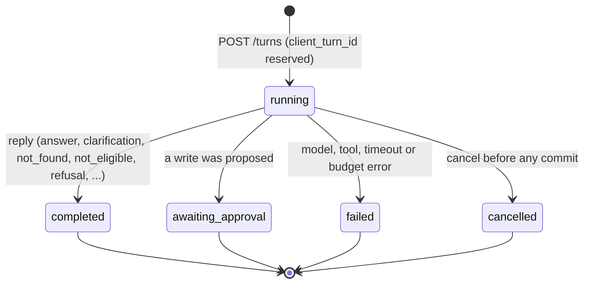
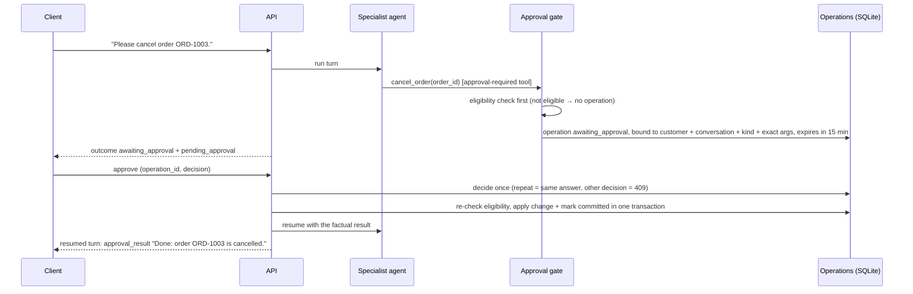

# API, approval, and state flow

How a conversation moves through the API, how a write gets approved and executed exactly once, and what state a client can rely on. The [contract](../contracts/README.md) is normative; this page explains it. The examples are in the [runbook](runbook.md#exercise-the-api).

## Routes at a glance

| Step | Route | Result |
| --- | --- | --- |
| Start | `POST /api/v1/conversations` | 201 `conversation` |
| Send a message | `POST …/conversations/{id}/turns` | `turn-result` (JSON), or a stream with `Accept: text/event-stream` |
| Look after a refresh | `GET …/conversations/{id}`, `GET …/turns/{turn_id}` | the active turn and pending approvals; a turn's state |
| Stop a turn | `POST …/turns/{turn_id}/cancel` | 202 |
| Decide | `POST …/conversations/{id}/approvals/{approval_id}` | the resumed turn's `turn-result` (or a stream) |
| Check a write | `GET /api/v1/operations/{operation_id}` | the authoritative `operation` |

No request carries identity. The principal comes from the host, and anything owned by someone else returns the same `404 not_found` as something missing ([why](threat-model.md#core-rules)).

## A turn

- **Idempotent submission.** The same `client_turn_id` with the same message returns the original turn and never runs it again. With a different message it returns `409 client_turn_id_reused`.
- **One turn at a time per conversation.** A second turn gets `409 turn_in_progress`, with the active turn's id.
- **Detached from the connection.** A turn runs on its own, so a dropped connection doesn't stop it and isn't a cancellation. `GET …/turns/{turn_id}` shows `running` and then the finished result.
- **Failures are results.** A turn that couldn't finish is a stored `failed` turn (HTTP 200) with an `error.code`, never an unhandled 500.

## A write: propose, decide, execute once

- **The decision can't change the action.** It carries only `operation_id`, `approve` or `reject`, and an optional reason. The arguments were bound when the operation was proposed.
- **Eligibility is checked twice.** It is checked before asking, so a customer is never asked to approve something impossible, and again, authoritatively, when the approved write runs.
- **At most once.** Status changes are guarded, and the write and its committed mark are one transaction. Repeating a decision returns the current result and never writes again. A restart in between is safe, because the operation and the paused native request are stored ([0003](decisions/0003-state-and-idempotency.md)).
- **Reject.** Nothing changes, and the operation becomes `rejected`. The model is told not to ask again straight away. On the Python backend, the reason the customer gives never reaches the model.

| Operation status | Meaning |
| --- | --- |
| `awaiting_approval` | proposed, waiting until `expires_at` |
| `rejected` / `expired` | nothing changed |
| `running` | approved and executing |
| `committed` | the change is recorded; `result` holds the facts |
| `failed` | approved but not executed (`not_eligible`, `not_found`, `timeout`, `cancelled`, `internal_error`); nothing changed |

## Streaming and cancellation

- **Events.** With `Accept: text/event-stream` a turn streams `turn.started`, `turn.progress` (stage, route, tool name; never content), `reply.delta` (live model tokens), `reply.reset`, and exactly one `turn.final` carrying the result.
- **Partial text is display-only.** It never drives routing or approvals. `turn.final`, or a `GET`, is authoritative.
- **Cancellation is cooperative.** It stops at a defined point before any commit. A write that already committed stays committed and is reported as committed; nothing is rolled back.

## Where each backend implements this

| Concern | .NET | Python |
| --- | --- | --- |
| Endpoints | `Modules/Conversations/Presentation` | `api.py` |
| Approval gate and operations | `Modules/Triage/Infrastructure/Routing/ApprovalGate`, `Modules/Operations` (`OperationService`, `SqliteOperationStore`) | `approval_gate.py`, `operations.py` |
| Store | `Common/Infrastructure/Persistence` (Microsoft.Data.Sqlite) | `database.py` (`sqlite3`) |
| Streaming | MAF `RunStreamingAsync` → SSE | `streaming.py` (FastAPI `EventSourceResponse`) |
| Cancellation | per-turn `CancellationTokenSource` | `turn_control.py` (`TurnCancelled`) |

The details are in the [.NET README](../src/dotnet/README.md#approvals-l10) and the [Python README](../src/python/README.md#approvals-l37).
