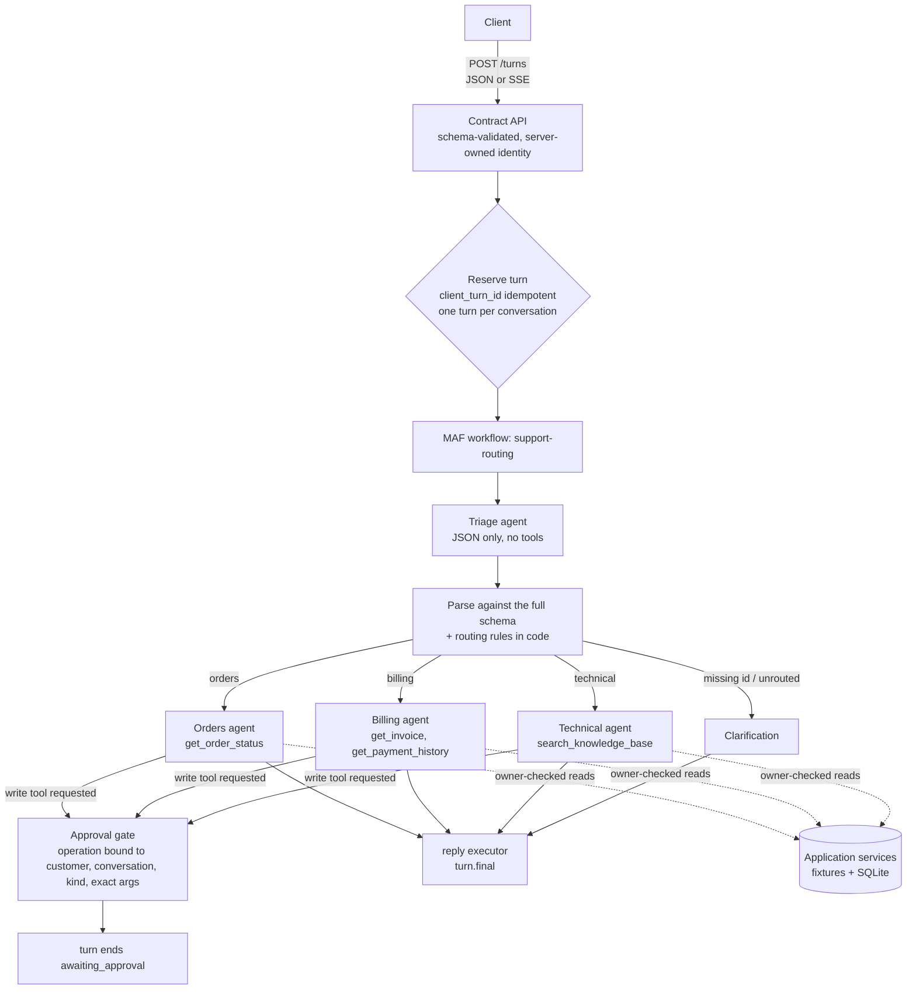

# Architecture

One customer-support use case, built twice with Microsoft Agent Framework (MAF): an ASP.NET Core API in C# and a FastAPI service in Python. Both implement one [shared contract](../contracts/README.md) over the same [synthetic fixtures](../fixtures/README.md), and both run under one Aspire AppHost for local development. They share nothing at runtime: each has its own process, store and telemetry.

## The pieces

| Piece | What it is | Details |
| --- | --- | --- |
| `apphost/` | Aspire AppHost (`Aspire.AppHost.Sdk` 13.6.5). Starts `support-api-dotnet`, `support-api-python` and the Python DevUI (`support-devui-python`), watches `/health`, and collects their OpenTelemetry. | [runbook](runbook.md) |
| `src/dotnet/` | `Support.Api`: ASP.NET Core on .NET 11, MAF 1.28.0. One project with module folders, each layered Domain / Application / Infrastructure / Presentation and enforced by ArchUnitNET tests. | [.NET README](../src/dotnet/README.md), [code layout](decisions/0002-code-layout.md) |
| `src/python/` | `support_agent`: FastAPI with Uvicorn on Python 3.15, MAF Python 1.25.0, uv-locked, pyright strict. | [Python README](../src/python/README.md) |
| `contracts/` | Version 1 of the API as JSON Schemas: requests, results, stream events, errors. Includes the cross-backend probes. | [contract](../contracts/README.md) |
| `fixtures/` | Synthetic customers, orders, invoices, payments, knowledge base and policies, plus 19 feature scenarios. | [fixtures](../fixtures/README.md) |
| `evaluations/` | Datasets, the evaluation runner (deterministic, native MAF, model-judged), and reports. | [evaluations](../evaluations/README.md) |

## One turn

Each backend runs the same pipeline. A customer message becomes a **turn**. Triage classifies it, code routes it, and a specialist agent answers using only its own tools. A write never happens inside the turn: it pauses for the customer's approval.

- **The model never decides authority.** The principal comes from the host, not the request. Every read and write checks ownership in application code, and another customer's record looks exactly like a missing one ([threat model](threat-model.md)).
- **Triage output is data, not instructions.** It is validated against the full contract schema, and then routing rules in code check that the action matches the target. Invalid output gives a clarification; it never guesses a route.
- **Writes are proposals.** `cancel_order`, `refund_order` and `create_ticket` are MAF approval-required tools. The gate turns the native approval request into an **operation**: bound, expiring after 15 minutes, decided once and run at most once. See [API, approval, and state flow](api-flow.md).

## State

| State | Where | Survives a restart |
| --- | --- | --- |
| Conversations, turns, operations, native approval requests, agent sessions, simulated business changes | One SQLite file per backend and per run (`.data/dotnet/support.db`, `.data/python/support.db`) | Yes |
| Running turns, cancellation tokens, live stream subscribers | Process memory | **No.** A turn is stored only when it finishes, so a turn interrupted by a crash is lost: after a restart, `GET …/turns/{id}` returns 404. Retry with the same `client_turn_id`. A write the turn had already committed stays committed, and its operation record says so. |

A write and its "committed" mark are one transaction, and status changes are guarded, so a write is applied at most once. The reasoning and the limits are in [0003 - Durable state and idempotent writes](decisions/0003-state-and-idempotency.md).

## Two SDKs, one behaviour

The backends are native to their stacks: MAF Workflows and `ChatClientAgent` in .NET; `Agent`, `WorkflowBuilder` and middleware in Python. They must agree on everything a client can see. 29 black-box HTTP probes compare the two on every push, and the evaluation datasets run against both. Where the SDKs differ, and why it doesn't leak, is in [0004 - SDK comparison](decisions/0004-sdk-comparison.md).

## Cross-cutting concerns

| Concern | Page |
| --- | --- |
| Traces, metrics and logs per backend into the Aspire dashboard | [observability](observability.md) |
| Identity, access matrix, prompt injection, operation risk | [threat model](threat-model.md) |
| Timeouts, retries and per-turn model-call budgets | [observability: failures, retries and budgets](observability.md#failures-retries-and-budgets) |
| Offline, live and reproducible checks | [testing](testing.md) |
| Behaviour, native and model-judged evaluation | [evaluations](evaluations/README.md) |
| Concurrency, faults, latency and throughput | [fault and load](evaluations/load.md) |
| Security review, code scanning, production requirements | [threat model: security review](threat-model.md#security-review-2026-11-12) |
| Seeing it work, on both backends | [demonstration](demo.md) |

## Under load

In fake mode on one 18-CPU machine, the .NET backend handles about 1,500 requests/s at 16 concurrent conversations, with a p50 of about 2 ms. The Python backend handles about 600 requests/s on its single event loop. Isolation, one write per approval, and one winner per decision race hold on both, and CI checks them on every push. Reusing SQLite connections removed 150–190 ms write tails in .NET and doubled Python's throughput ([load results](evaluations/load.md)).

## What it is not

A demonstration system, not a production service. It has:

- one development principal per process, with no real authentication;
- simulated writes;
- local SQLite, one process per database file;
- no rate limiting and no retention policy.

The [production requirements](threat-model.md#production-requirements-explicit-follow-ups) list what a deployment would need.
