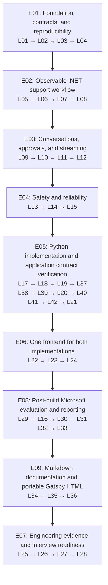

# Ordered learning roadmap

Work one ticket at a time in execution order. Ticket IDs are stable identifiers, not execution positions; follow the Order column and blocking links. Only the first unblocked ticket is Ready.

The [alignment contract](alignment.md) fixes cross-ticket scope and the [capability map](capabilities.md) identifies prerequisites. Source metadata lives in backlog.json and ../sources.json; generated ticket/epic pages must be rerendered when it changes.

## Learning path at a glance

Each arrow means finish the preceding phase before starting the next. The ticket IDs inside each box follow execution order, including L16's later evaluation position.

The table below is the text alternative and includes the exact prerequisites. Formal evaluations start after L24; Gatsby documentation starts after L33. Final portfolio work refreshes the static documentation after the fault and security reviews.

## Ticket execution order

| Order | Ticket ID | Epic | Learning ticket | Stack | Depends on |
| --- | --- | --- | --- | --- | --- |
| 1 | L01 | E01 | [Audit Chapter 7 and record a verified version baseline](tickets/L01.md) | shared | None |
| 2 | L02 | E01 | [Define shared support contracts and synthetic fixtures](tickets/L02.md) | shared | L01 |
| 3 | L03 | E01 | [Scaffold .NET support API and C# Aspire AppHost](tickets/L03.md) | dotnet | L02 |
| 4 | L04 | E01 | [Add reproducible builds and meaningful offline CI](tickets/L04.md) | dotnet | L03 |
| 5 | L05 | E02 | [Build the first .NET order-status agent and DevUI](tickets/L05.md) | dotnet | L04 |
| 6 | L06 | E02 | [Export traces, metrics, and structured logs to Aspire](tickets/L06.md) | dotnet | L05 |
| 7 | L07 | E02 | [Implement validated triage and deterministic routing](tickets/L07.md) | dotnet | L06 |
| 8 | L08 | E02 | [Complete read-only .NET billing and technical specialists](tickets/L08.md) | dotnet | L07 |
| 9 | L09 | E03 | [Add per-conversation sessions and preserve context](tickets/L09.md) | dotnet | L08 |
| 10 | L10 | E03 | [Require bound approval for simulated support mutations](tickets/L10.md) | dotnet | L09 |
| 11 | L11 | E03 | [Persist pending approvals and prevent duplicate operations](tickets/L11.md) | dotnet | L10 |
| 12 | L12 | E03 | [Implement streaming, cancellation, and terminal events](tickets/L12.md) | dotnet | L11 |
| 13 | L13 | E04 | [Verify customer access and conversation ownership boundaries](tickets/L13.md) | dotnet | L12 |
| 14 | L14 | E04 | [Validate tool boundaries and exercise prompt injection](tickets/L14.md) | dotnet | L13 |
| 15 | L15 | E04 | [Add bounded timeouts, retries, and graceful failure](tickets/L15.md) | dotnet | L14 |
| 16 | L17 | E05 | [Scaffold Python packaging, health, and Aspire integration](tickets/L17.md) | python | L15 |
| 17 | L18 | E05 | [Implement Python read-only agents, tools, and triage](tickets/L18.md) | python | L17 |
| 18 | L19 | E05 | [Implement isolated Python conversation sessions](tickets/L19.md) | python | L18 |
| 19 | L37 | E05 | [Add bound Python approvals for simulated mutations](tickets/L37.md) | python | L19 |
| 20 | L38 | E05 | [Persist Python approvals and atomic operation records](tickets/L38.md) | python | L37 |
| 21 | L39 | E05 | [Verify Python customer and operation ownership boundaries](tickets/L39.md) | python | L38 |
| 22 | L20 | E05 | [Implement Python streaming and cooperative cancellation](tickets/L20.md) | python | L39 |
| 23 | L40 | E05 | [Export Python traces, logs, and metrics to Aspire over OTLP](tickets/L40.md) | python | L20 |
| 24 | L41 | E05 | [Exercise Python prompt-injection and tool-validation boundaries](tickets/L41.md) | python | L40 |
| 25 | L42 | E05 | [Bound Python retries, timeouts, and execution budgets](tickets/L42.md) | python | L41 |
| 26 | L21 | E05 | [Verify cross-language application contracts and document SDK decisions](tickets/L21.md) | shared | L42 |
| 27 | L22 | E06 | [Verify browser compatibility with the established API contract](tickets/L22.md) | frontend | L21 |
| 28 | L23 | E06 | [Build shared chat UI with backend selection](tickets/L23.md) | frontend | L22 |
| 29 | L24 | E06 | [Add approval UI, recovery states, and trace references](tickets/L24.md) | frontend | L23 |
| 30 | L29 | E08 | [Set up post-build evaluation projects, datasets, and result contracts](tickets/L29.md) | shared | L24 |
| 31 | L16 | E08 | [Build the shared deterministic behavior evaluation runner](tickets/L16.md) | shared | L29 |
| 32 | L30 | E08 | [Integrate Microsoft .NET evaluation APIs with local checks](tickets/L30.md) | dotnet | L16 |
| 33 | L31 | E08 | [Integrate native Python local agent and workflow evaluations](tickets/L31.md) | python | L30 |
| 34 | L32 | E08 | [Add budgeted model-based quality evaluation for both backends](tickets/L32.md) | shared | L31 |
| 35 | L33 | E08 | [Generate Microsoft evaluation reports and separate CI lanes](tickets/L33.md) | shared | L32 |
| 36 | L34 | E09 | [Author canonical Markdown documentation for the completed system](tickets/L34.md) | docs | L33 |
| 37 | L35 | E09 | [Build Gatsby Markdown-to-static-HTML documentation](tickets/L35.md) | docs | L34 |
| 38 | L36 | E09 | [Validate and package copyable Gatsby static documentation](tickets/L36.md) | docs | L35 |
| 39 | L25 | E07 | [Run fault, concurrency, and bounded load exercises](tickets/L25.md) | shared | L36 |
| 40 | L26 | E07 | [Review dependencies, security checks, and operational limits](tickets/L26.md) | shared | L25 |
| 41 | L27 | E07 | [Publish the architecture, runbook, and portfolio demonstration](tickets/L27.md) | shared | L26 |
| 42 | L28 | E07 | [Complete a mock interview and independent change exercise](tickets/L28.md) | shared | L27 |

## Epics

### [E01: Foundation, contracts, and reproducibility](epics/E01.md)

Explain the architecture, freeze a verified baseline, and start a buildable .NET/Aspire skeleton.

Exit: A fresh checkout restores, builds, and starts the skeleton; the API and synthetic data contracts are documented.

### [E02: Observable .NET support workflow](epics/E02.md)

Implement the read-only Chapter 7 support path with guarded tools, routing, DevUI, and telemetry.

Exit: Demonstrate read-only orders, billing, and technical requests with correlated workflow/model/tool telemetry; mutating tools remain unregistered until E03.

### [E03: Conversations, approvals, and streaming](epics/E03.md)

Preserve conversation state and safely pause/resume side-effecting work.

Exit: Demonstrate isolated follow-ups, bound approval/rejection for all simulated writes, restart/resume, duplicate protection, and the shared streaming terminal outcomes.

### [E04: Safety and reliability](epics/E04.md)

Strengthen established ownership/tool boundaries and bound .NET failures before implementing the Python project.

Exit: Feature-level ownership, injection-boundary, cancellation, retry, and resource-budget checks pass. The formal evaluation harness is deferred until all application projects are built.

### [E05: Python implementation and application contract verification](epics/E05.md)

Build the equivalent Python support API, then verify the completed backend projects through their integration/contract checks.

Exit: Both backend projects build and pass their feature/contract tests for ownership, approvals, durable state, streaming, and resilience. This is the prerequisite for the frontend, not the formal evaluation phase.

### [E06: One frontend for both implementations](epics/E06.md)

Verify browser compatibility with the established backend contract and add one shared frontend.

Exit: Select a backend when starting a conversation, chat, approve/reject an operation, and diagnose a failure. The two APIs and shared frontend build and run with their feature tests passing, establishing application_projects_built.

### [E08: Post-build Microsoft evaluation and reporting](epics/E08.md)

After the .NET, Python, and frontend projects are built, create shared evaluation datasets/runners, integrate native Microsoft evaluation APIs, and report deterministic and budgeted judge results.

Exit: Both targets run the same versioned behavior datasets; native .NET/Python evaluations are demonstrated; model-based scores are separated from business gates; reproducible reports and CI artifacts exist.

### [E09: Markdown documentation and portable Gatsby HTML](epics/E09.md)

After the application projects and evaluation reporting exist, author plain Markdown and render it with Gatsby into a portable static HTML/assets folder.

Exit: One canonical Markdown source feeds a locked Gatsby build. The complete public folder can be copied and served by an ordinary static server with correct routes/assets and no application backend, model service, or Gatsby runtime.

### [E07: Engineering evidence and interview readiness](epics/E07.md)

Use the completed applications, evaluations, and static documentation to demonstrate engineering evidence and interview readiness.

Exit: Complete a fault demonstration, publish a reproducible runbook, and answer a recorded or written mock interview.
